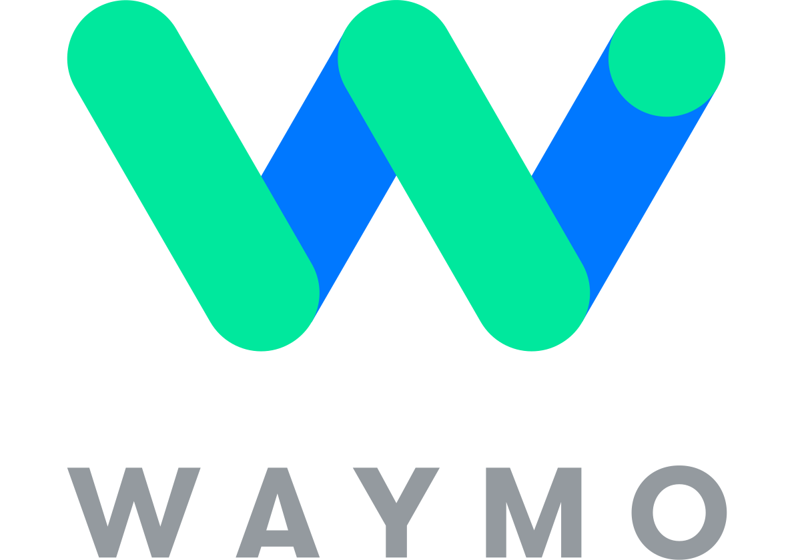
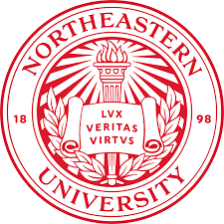
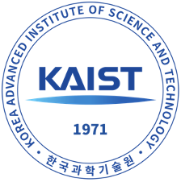
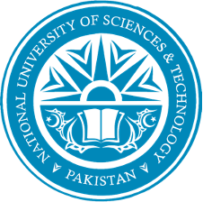

I am a PhD candidate in Electrical Engineering at [Northeastern University](https://www.northeastern.edu/), working with the [Machine Learning group @ SPIRAL](https://mllabneu.github.io/) supervised by [Professor Jennifer Dy](https://scholar.google.com/citations?user=6h7b0fAAAAAJ&hl=en). My current research interests include 3D computer vision (particularly 3D reconstruction and novel-view synthesis), generative modeling, continual learning, adversarial attacks, and leveraging them for interpretability. Additionally, I have worked on unsupervised 3D reconstruction and classification, time-series forecasting and implicit neural networks. 

This summer, I interned at Waymo with the Perception Team, working on sensor fusion. Previously, I interned with Google's Project Starline (now Google Beam) and developed a novel feed-forward framework for efficient and scalable 3D reconstruction and NVS, achieving state-of-the-art performance in a single inference pass.

Besides my academic interests, I enjoy community service and reading biographies.

<h2 style="margin-top: 2em;">Research Interests</h2>
- 3D computer vision (reconstruction, novel view sythesis, diffusion models)
- Adversarial attacks for robust and interpretable ML
- 3D and 2D object detection, representation learning, segmentation, tracking

<h2 style="margin-top: 2em;">Work Experience</h2>
 &nbsp;&nbsp; May - August 2026 \
&nbsp;&nbsp; PhD Intern, Perception Team, Waymo, Mountain View CA

 &nbsp;&nbsp; June - November 2025 \
&nbsp;&nbsp; Student Researcher, Pixel Biometrics AI Research (BAIR), Google, Seattle WA

 &nbsp;&nbsp; May 2024 - May 2025 \
&nbsp;&nbsp; Research Intern, [Google Beam](https://starline.google/), Google, Playa Vista, CA

 &nbsp;&nbsp; Sept 2021 - Dec 2026\
&nbsp;&nbsp; Graduate Research Assistant at [Machine Learning Lab](https://mllabneu.github.io/), [SPIRAL](https://web.northeastern.edu/spiral/)

 &nbsp;&nbsp; Sept 2020 - Aug 2021\
&nbsp;&nbsp; External Consultant for ML and AI

 &nbsp;&nbsp; Sept 2018 - Aug 2020\
&nbsp;&nbsp; Graduate Research Assistant at [Robotics and Computer Vision (RCV) Lab](http://rcv.kaist.ac.kr/index.php?mid=rcv_01_01)

 &nbsp;&nbsp; Sept 2015 - May 2018\
&nbsp;&nbsp; Research Intern at [TUKL NUST R&D Centre](https://tukl.seecs.nust.edu.pk/)

<h2 style="margin-top: 2em;">News</h2>
- {{ item }}


<h2 style="margin-top: 2em;">Talks</h2>

**CD-RCM @ Voxel51's Boston Physical AI Workshop**

  <iframe src="https://www.youtube-nocookie.com/embed/K15EWVQ45Y4" title="Talk on CD-RCM" style="position: absolute; width: 100%; height: 100%; border: 0;" allow="accelerometer; autoplay; clipboard-write; encrypted-media; gyroscope; picture-in-picture; web-share" referrerpolicy="strict-origin-when-cross-origin" allowfullscreen></iframe>

**LVT @ Voxel51's AI, ML and CV Meetup**

  <iframe src="https://www.youtube-nocookie.com/embed/i3MCZFfQcjs" title="Talk on LVT at Voxel51's AI, ML and CV Meetup" style="position: absolute; width: 100%; height: 100%; border: 0;" allow="accelerometer; autoplay; clipboard-write; encrypted-media; gyroscope; picture-in-picture; web-share" referrerpolicy="strict-origin-when-cross-origin" allowfullscreen></iframe>

<h2 style="margin-top: 2em;">Teaching</h2>
- Teaching Assistant for [EECE7397 Advanced Machine Learning](https://www.coursicle.com/neu/courses/EECE/7397/), Northeastern University.

<h2 style="margin-top: 2em;">Academic Service</h2>
- Workflow Chair: AAAI 2024
  - Managed the AAAI 2024 paper review process for 12,100 submissions, working with 7k reviewers, 765 senior program committee (SPC), and 320 area chairs (AC).
  - Used topic modeling and text similarity to determine reviewer, SPC, and AC assignments.
- Conference Reviewer: AAAI 2027, NeurIPS 2025-26, ICLR 2025-26, CVPR 2024, ECCV 2024, ACCV 2024, ICCV 2023, NeurIPS 2023 (New in ML Workshop)
- Volunteer: ICML 2022